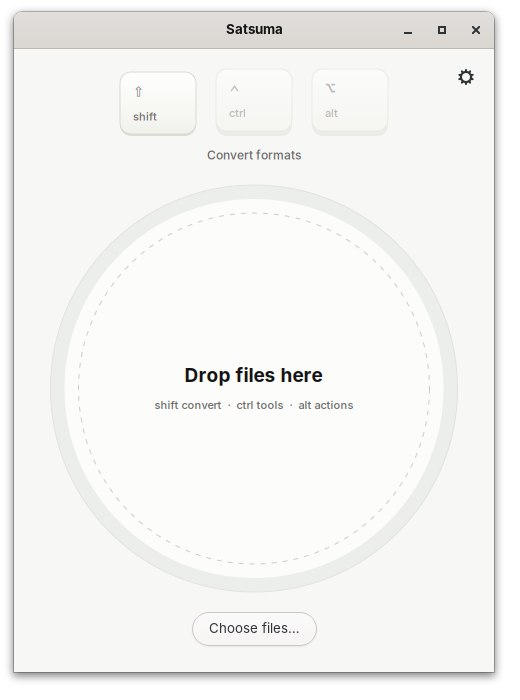
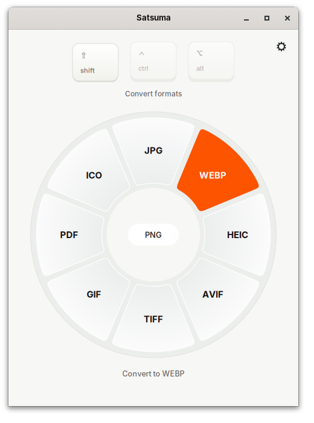
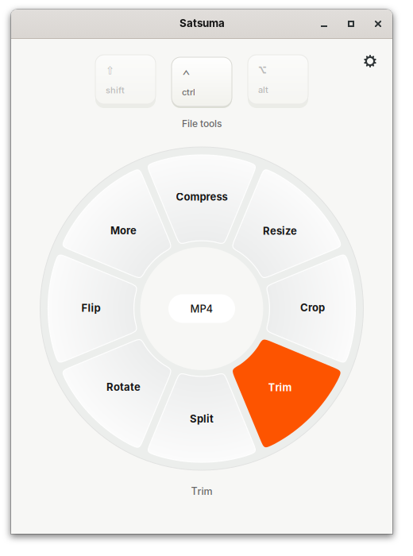
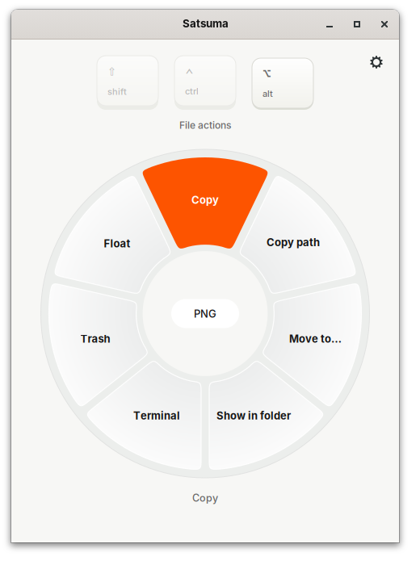
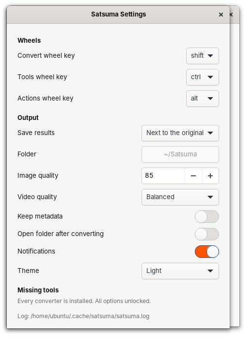
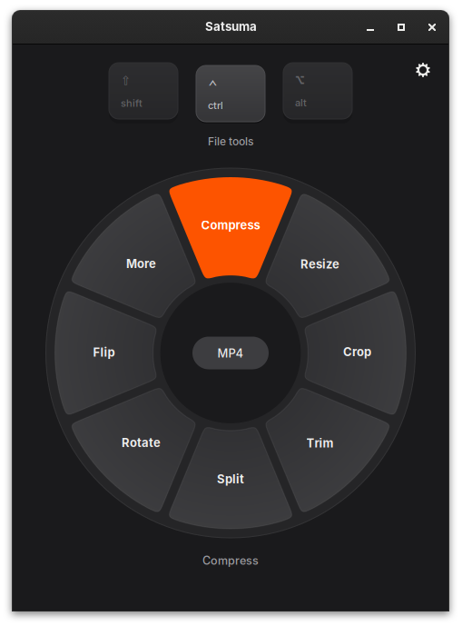
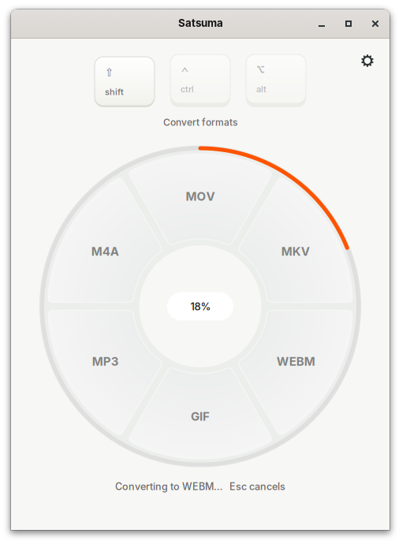
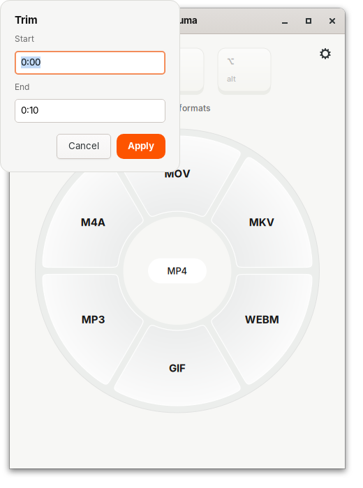

# Satsuma

Satsuma is an offline file converter for Linux. You drop a file on a wheel, flick to a slice, and the result lands next to the original. It handles images, audio, video, PDFs, documents, slides, spreadsheets, subtitles and archives using tools already on your machine (ffmpeg, ImageMagick, poppler, pandoc, LibreOffice). Nothing is uploaded.

Inspired by Tangerine for Mac. Satsuma is an independent clean-room project with its own name, icon and copy.

| | | |
|---|---|---|
|  |  |  |
| Drop window | Convert wheel (PNG) | Tools wheel (MP4, slice hovered) |
|  |  |  |
| Actions wheel | Settings | Dark theme |
|  |  | |
| Progress ring mid-job | Trim prompt | |

## Install

**Ubuntu 24.04+ / Debian:** download `satsuma_<version>_all.deb` from the latest GitHub release, then run:

```sh
sudo apt install ./satsuma_*_all.deb
```

**Any distro** (files go to `~/.local`; run it with sudo to also install the tools through apt, dnf or pacman):

```sh
curl -fsSL https://raw.githubusercontent.com/anmolxlight/satsuma/main/install.sh | bash
```

Run `./uninstall.sh` to remove it. **Build the .deb yourself** with `bash packaging/build-deb.sh`, which writes `dist/satsuma_<version>_all.deb`. There is also an RPM spec in `packaging/satsuma.spec`.

## Use

- **Drop window** (`satsuma`): drop one or more files onto the wheel. If you drop straight onto a slice, it runs with no click at all. You can also paste files with Ctrl+V, or use **Choose files…** (Ctrl+O).
- **Wheels:** hold or tap **Shift** for Convert, **Ctrl** for Tools and **Alt** for Actions. You can change these keys in Settings. Tab and Shift+Tab cycle through the wheels, the arrow keys move between slices, Enter applies, and Esc cancels a running job or closes the popup. If a wheel has more than 10 options, it shows them in pages with a **More** slice.
- **Popup** (`satsuma --popup FILE...`): a borderless wheel centred on the mouse pointer (on Wayland, centred on the screen). It closes after an action, on Esc, or when it loses focus. File manager integrations use this mode.
- **File managers:** right-click → **Satsuma…** works in Nautilus (needs `python3-nautilus`), Nemo and Dolphin straight after installing. For the Nautilus *Scripts* menu and Thunar, run `/usr/share/satsuma/integrate-user.sh` once (install.sh does this for you).
- **Global shortcut:** in your desktop's keyboard settings (GNOME: Settings → Keyboard → Custom Shortcuts), bind a key such as Super+S to `satsuma --selection`. Copy files in your file manager (Ctrl+C), press the key, and the popup opens for those files. `--selection` reads the clipboard, because file managers don't expose their selection to other programs. Bind `satsuma` instead if you'd rather get the drop window.
- **Batch:** if you select several files of the same kind, the wheel shows only the options they all share and processes them as one job with a combined progress ring. A mixed selection gets Actions plus Zip.
- **CLI:**
  ```sh
  satsuma --convert photo.heic jpg               # prints the output path
  satsuma --tool trim talk.mp4 start=0:05 end=1:30
  satsuma --tool merge a.pdf b.pdf
  satsuma --list file.pdf                        # what Satsuma can do with it
  ```

Output always goes next to the source (or to a folder you choose in Settings) and never overwrites anything: a second conversion becomes `photo 2.jpg`. Each result is written to a hidden temp file and renamed only once it's complete, so a cancel or a crash never leaves a half-written file behind. Errors are shown in plain language, and the full tool output goes to `~/.cache/satsuma/satsuma.log`.

## What it does

| Family | In | Out | Tool |
|---|---|---|---|
| Images | jpg png webp heic avif tiff bmp svg ico | jpg png webp heic avif tiff gif pdf ico | ImageMagick, heif-enc for HEIC |
| Audio | mp3 m4a wav flac ogg opus aiff wma aac | mp3 m4a wav flac ogg opus aiff | ffmpeg |
| Video | mp4 mov mkv webm gif avi wmv m4v | mp4 mov mkv webm gif mp3 m4a (gif also → png/jpg/webp first frame) | ffmpeg |
| PDF | pdf | docx odt pptx xlsx jpg png txt md html epub | LibreOffice, poppler, pandoc |
| Docs | docx doc odt rtf md txt html epub pages | docx odt pdf md txt html epub rtf | pandoc, LibreOffice |
| Slides | pptx ppt odp key | pdf pptx odp jpg png | LibreOffice + pdftoppm |
| Sheets | xlsx xls ods csv tsv | xlsx ods csv tsv pdf html | LibreOffice, stdlib csv |
| Subtitles | srt vtt ass | srt vtt txt | ffmpeg, stdlib |
| Archives | zip tar tgz gz bz2 xz 7z rar | extract to folder | stdlib, unar |

**Tools (Ctrl):** Compress, Resize, Crop, Trim, Split (PDF pages / media parts), Merge, Rotate, Flip, Grayscale, Strip metadata, Extract audio, Mute, Speed, To GIF, To PDF, To images, Frame rate, Normalize, Fade in/out, Frames, Encrypt PDF, Decrypt PDF, Zip, Tar.gz.

**Actions (Alt):** Copy (as files, so pasting in a file manager works), Copy path, Move to…, Show in folder, Terminal, Trash, Float, Send (only if LocalSend or KDE Connect is installed).

If a tool is missing, the options that need it are hidden. Settings lists the exact install command for each missing tool and how many options it would unlock.

## Decisions

These are the defaults I picked where the spec left room:

- **App ID** `io.github.anmolxlight.Satsuma`, repo URL `github.com/anmolxlight/satsuma`. No remote is configured yet, so the install one-liner and release links assume that URL.
- **GIF counts as video** (animated input). To get a still, pick PNG/JPG/WebP, which converts the first frame. GIF is still offered as an *output* for images.
- **Pages/Keynote files** are read through the preview PDF or JPEG embedded in the bundle. That's the only part readable without Apple software.
- **PDF → XLSX** uses a heuristic: it splits the layout text on runs of two or more spaces into a CSV, then LibreOffice turns that into XLSX. It's good for simple tables, not complex statements.
- **PDF → DOCX/ODT** uses LibreOffice's `writer_pdf_import`, which keeps the layout and puts the text in frames.
- **LibreOffice runs one job at a time** under a private profile (`/tmp/satsuma-lo-<uid>`). That way it works while you have LibreOffice open, at the cost of running batches serially.
- **Compression levels** follow Settings. Image compress uses image quality capped at 75. Video compress uses the chosen CRF preset +5. Audio is 96 kbps and PDFs use Ghostscript `/ebook`.
- **Crop** works by aspect ratio (presets or a custom `W:H`) and centres the crop; for PDFs it sets the CropBox on every page.
- **Passwords** for encrypting and decrypting PDFs are passed to qpdf through a 0600 temp `@argfile`, never on the command line where `ps` could show them.
- **One app instance:** a second `satsuma --popup` call is forwarded to the running app, so notification buttons keep working. A popup keeps the process alive for 60 s after closing so **Show in folder** on the notification still works.
- **Float** shows a still preview (first video frame, first PDF page) and is kept on top through `_NET_WM_STATE_ABOVE` on X11. GTK 4 has no keep-above API and Wayland doesn't allow it, so there it's a normal small window.
- **Popup positioning** queries the pointer and moves the window through libX11 (ctypes, no extra dependency) on X11. On Wayland the compositor places it.
- **`--selection`** reads the clipboard (files copied with Ctrl+C in Nautilus, Nemo, Dolphin or Thunar) rather than the live selection, which file managers don't expose. `--popup` with no files does the same.
- **Debian 12** ships GTK 4.8, but Satsuma's file chooser needs GTK ≥ 4.10. The CLI and conversions work there; the GUI needs a newer GTK.
- **HEIC output** needs the x265 plugin for libheif (`libheif-plugin-x265`), which is in the package's Recommends.
- **Screenshots:** Chromium's plain `--screenshot` flag gives a blank page with Broadway, because the page never finishes loading (it holds a websocket open). `docs/screenshots.sh` drives the same headless Chromium over the DevTools protocol instead (`docs/shoot.mjs`), waits, then captures.
- **Website** (`web/`) is plain static HTML, CSS and JS with no build step. Point Vercel (or any static host) at `web/`.

## Development

```sh
python3 tests/test_satsuma.py   # real conversions + GUI smoke test (broadway); prints SKIP for missing tools
ruff check .
bash packaging/build-deb.sh && lintian dist/*.deb
bash docs/screenshots.sh        # regenerate docs/screenshots (needs gtk4-broadwayd, chromium, node)
```

Layout: `satsuma/` (formats, convert, tools, actions, jobs, config, `ui/`), `data/` (desktop file, icons, metainfo, file manager hooks), `packaging/`, `web/`, `tests/test_satsuma.py`.

MIT licensed.
